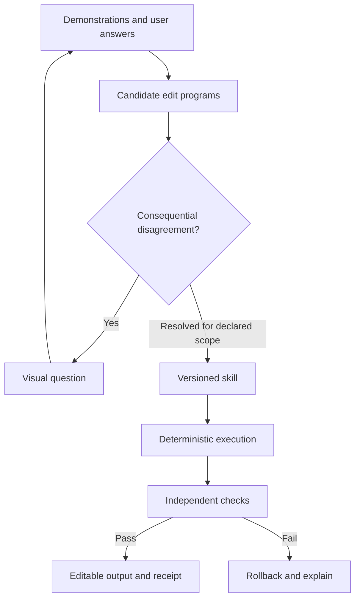

# Open Apprentice — redesign and implementation handoff for Claude Code

**Version:** Redesign 1.0  
**Prepared:** 13 October 2026, Asia/Singapore  
**Owner:** Aryan Ganju, solo builder  
**Submission deadline:** 30 October 2026, 17:00 UTC / 31 October 2026, 01:00 SGT  
**Planning horizon:** approximately 17 days; check the remaining time when starting  
**Recommended track:** Coding and Agentic Engineering  
**Purpose:** A self-contained implementation brief for an existing repository on another device.  
**Status:** Proposed redesign and acceptance plan. This document does not establish that the redesign has been implemented or validated.

## 0. Start here

Read this document fully before changing the architecture. Inspect the actual repository, its instructions, current implementation, tests, logs, and deployment configuration. Map this specification onto the existing code rather than generating a new application scaffold.

The owner authorizes pursuing the redesign described here. Start with a three-day capability experiment, preserve the working application, and use the explicit continuation gate in section 4. Continue autonomously with reversible implementation, local checks, documentation, and existing authorized workflows. Do not repeatedly ask permission for ordinary engineering decisions. Honor existing user authorizations and repository instructions. Do not infer permission for new purchases, unbudgeted inference batches, public publishing, or production replacement from this document alone; prepare a concrete change or capped run proposal if authorization is missing. Missing credentials or budget should block live inference only, not deterministic implementation and validation.

This is a new handoff, separate from `Open_Apprentice_Claude_Code_Build_Spec.md` v1.3, dated 9 October 2026. Where this document deliberately changes product scope, model responsibilities, adapter implementation, evaluation, or schedule, it supersedes that earlier proposal. Existing verified behavior and current repository evidence take precedence over historical descriptions. Do not delete earlier work merely because it is no longer the headline feature.

### 0.1 The central decision

Build **a teachable visual editing system that turns demonstrations and corrections into reusable, conditional edit programs**. The first application to test is recurring edits to technical diagrams and annotated figures.

The learning target is a small program containing object selection, relationships, conditions, and coordinated position changes. Nemotron proposes and revises that program. Deterministic adapters execute it in supported engines. Independent checks measure actual results and preservation. Humans resolve preferences.

The desired experience is:

> Teach a recurring edit, answer a useful question about an exception, and obtain a reusable tool that works on fresh supported documents without silently changing unrelated content.

The goal is an exceptional hackathon submission. A 9–10/10 ambition is not a requirement to report a high score. No score, prize, research novelty, user demand, or performance claim is established by this document. Do not place subjective numerical ratings in the public README.

### 0.2 Reading map

| Need | Sections |
| --- | --- |
| Existing evidence and hackathon context | 1–2 |
| Product decision and three-day gate | 3–4 |
| Architecture, scene model, learned language | 5–7 |
| Learning, questions, corrections, checking | 8–11 |
| Files, adapters, UI, APIs, persistence | 12–15 |
| Inference, evaluation, tests, delivery | 16–20 |
| Demo, claims, sources, kickoff prompt | 21–24 |

## 1. What exists, what was corrected, and what remains unknown

The following is the owner's reported status as of 13 October. Verify it locally before treating it as tested implementation evidence.

| Item | Reported status | How to treat it |
| --- | --- | --- |
| NVIDIA model integration | Live Nemotron-3-Ultra calls through Nebius Token Factory | Preserve the working provider integration; obtain the actual configured model identifier from the repository/account |
| Deployment | Application runs on Google Cloud Run | Preserve the existing deployment; locate its real URL, do not invent it |
| Graphics engines | Real Konva and Fabric execution in a restricted browser environment | Reuse working harnesses and pin current dependency versions |
| Candidate learning | Model proposals plus exact enumeration in a small rule language | Preserve the existing bounded path and document its exact grammar/search limits |
| Clarification | Z3 questions repeat until surviving candidates are behaviorally equivalent within the declared comparison scope | Verify timeout, unresolved, and equivalence semantics; do not reimplement based on the simplified walkthrough |
| Existing demo | Badge placement; two clarification answers, described as A then A | This is the fallback, not the target breadth of the redesign |
| Sealing | Hash covers rule, domain, and teaching record | Identity/integrity relative to a trusted reference; not proof of human intent |
| Checking | Geometry checker reads raw engine state with separate geometry code | Reuse after inspecting independence and supported features |
| Adapter repair | Nemotron's live repair attempts have not passed checks | Do not claim autonomous repair works |
| Repair fixture | Clearly labeled scripted repair exists | Retain as a fixture/regression case, exclude from model-success statistics |
| Export | Editable SVG plus offline evidence recheck | Recheck does not prove a browser or model actually executed |
| Gym | An environment built on NVIDIA NeMo Gym exists | Reuse the framework and measure environment errors separately |
| Gym pilot | 13 tasks: asked when needed but often did not finish | Development diagnostic only; exact denominators and failure causes needed |
| Gym fix | An ask-loop/refusal-message defect was found and changed; rerun pending | Inspect the change and rerun development cases before freezing evaluation |
| Scripted policies | `never_ask`, `always_ask`, and `calibrated` exist | Inspect observation access; a policy using hidden labels is an oracle reference |
| Documentation | `docs/demo_script.md` reportedly still said no public demo existed | Fix the stale statement after verifying the deployment URL |
| Git reference | Commit `ad126cc` was mentioned by the implementation assistant | Confirm what it contains and whether it exists; never assume it is the current HEAD or reset to it |

### 1.1 Corrected ambiguity example

A 150 px card with a 12 px margin is consistent with constant 12, proportional 8%, and proportional 8% clamped to [8, 24]. At width 300, the latter two both produce 24. At width 400, the outputs are 12, 32, and 24. The real loop reportedly asks additional questions; the earlier explanation was simplified. Do not advertise a single question as resolving all three at width 300.

### 1.2 Existing quantitative claims need reconstruction

The owner reported a small development pilot:

- Search alone: `0/12`.
- Model alone: `5/12 with 2 wrong`.
- Hybrid: `5 committed with 0 wrong`.
- Separately, an open model reportedly committed to a wrong rule 44% of the time in another measurement.

Recover raw records. Establish whether the five model outcomes were five correct plus two incorrect, or five commitments including two incorrect. Use the same denominator and distinguish correct completion, incorrect commitment, abstention, invalid program, environment failure, and timeout. Determine whether “outside the grammar” means outside the enumerator's bounded templates or outside the executable/checkable language. The latter requires additional evaluator support and cannot be assumed safe.

These results motivate a hypothesis: model proposals may extend useful coverage beyond bounded enumeration while interaction and checking reduce errors. They are not a validated general result, and they do not establish demand.

### 1.3 Initial audit deliverable

Create or update `docs/redesign_audit.md` with:

1. Actual branch/HEAD and working-tree state; preserve user edits.
2. Mapping from the responsibilities in this document to existing modules.
3. Current grammar, enumerator bounds, equivalence scope, and model-generated operations.
4. Actual provider/model configuration and secret names, without secret values.
5. Existing fixture versus live paths and current baseline observation access.
6. Status of the Gym environment fix and available raw development records.
7. Existing SVG round-trip support, fonts, transforms, groups, and export limitations.
8. Missing versus confirmed capabilities; estimated work for the three-day experiment.

Do not block implementation on an exhaustive audit. Timebox the first pass to a few hours. Preserve a local fallback branch or equivalent reversible checkpoint using the repository's established workflow; avoid destructive cleanup or a blind commit of unrelated changes.

## 2. Hackathon context and delivery obligations

The Nebius x NVIDIA Global AI Hackathon requires a working project using an NVIDIA open model through Nebius Token Factory or Nebius AI Cloud. Runtime Token Factory inference qualifies; Cloud Run can host the application. Coding and Agentic Engineering is the intended track. The deadline is 30 October 2026 at 17:00 UTC. [S1]

The official criteria are equally weighted: technological implementation, design, potential impact, and idea quality. Deliver a working demo, public licensed repository with setup instructions, a public YouTube video under three minutes, project description, chosen track, and technology feedback. Keep judging access available through 15 December 2026. Recheck official rules before submitting. [S1]

Our extra continuation gates and metrics below are engineering decisions, not official thresholds. Effective model use must be visible in teaching and program synthesis. Neither model size nor infrastructure complexity is evidence of quality.

The owner is building solo, can devote substantial time, and wants an ambitious AI/research-oriented project. Do not redirect the product toward Operations simply because of the owner's professional background. Existing code, API quotas, credits, and deployment costs must be inspected; available compute/budget has not been established here.

## 3. Product scope and deliberate changes

### 3.1 Initial user and job

Test the hypothesis that someone preparing multiple architecture diagrams, research figures, or technical presentation graphics wants to teach a recurring edit and apply it consistently across documents. Ask two or three relevant people for a real example early. The owner can recruit; do not message others on their behalf without authorization.

The initial concrete task family is **positioning attached annotations while preserving their content and the underlying diagram**. A user-selected annotation and its associated node provide grounded inputs. Association may be read from explicit document metadata or confirmed by the user. Inferring arbitrary visual semantics from pixels is outside the first scope.

An example learned policy might place attached labels to the right, use a preferred gap, move below when the right position is obstructed, and leave a selected class of annotations unchanged. This is an illustration of a program the system should learn. Do not ship it as a prewritten macro and count selecting it as learning.

### 3.2 Scope for the experiment

- Axis-aligned rectangles, single-line text labels, groups with translation only, and straight connectors.
- Movable targets are labels/annotation groups; their owning nodes remain fixed.
- Existing text, node positions, connector topology, object counts, and unrelated styles are protected by default.
- Initial annotations have a confirmed semantic association to a node but no leader line that would need to move with them. Graph connectors between fixed nodes remain unchanged. Reject moving an annotation with a geometry-dependent leader line until that behavior has a separately implemented and checked primitive; do not export visibly disconnected callouts as a success.
- At most 32 active objects and 16 movable labels per document initially. Reject or explicitly exclude larger documents; record exclusions.
- One label-placement operation per selected target, with at most two nested conditionals.
- Three teaching intentions: relative placement, conditional fallback, and scope/exception behavior.
- A supported file subset and editable export; general SVG import is not required.
- One engine can deliver the first complete vertical slice. Preserve the second engine and add conformance coverage after the core path works.

Numbers are starting implementation limits, not claims of tested capacity. Version any changes and freeze them before final evaluation.

### 3.3 What changes from the older plan

| Previous emphasis | New emphasis |
| --- | --- |
| Selecting simple badge rules | Synthesizing small compound editing programs |
| Model-written engine bindings | Deterministic adapters for declared primitives |
| Autonomous repair as a headline | Correct learning, scope, and reuse as the headline |
| Abstract synthetic questions first | Questions about actual batch documents first |
| Transfer mainly between libraries | Generalization across supported document structures, with engine portability as supporting evidence |
| A fixed rule sealed forever | Immutable versions; explicit new teaching creates a new version |
| Benchmark as a second product | Gym as supporting evaluation infrastructure |

Retain exact enumeration for its existing bounded subset. Broader model proposals lose any implication of exhaustive coverage over all possible programs. Keep that distinction in data and UI.

### 3.4 Explicit exclusions

Do not add arbitrary desktop control, robotics, new canvas frameworks, broad file-format support, model training, reinforcement learning, a generic multi-agent architecture, or a new cloud stack. No arbitrary Python/JavaScript generated by the model runs in the application. Do not spend the first week repairing the old injected-origin demo. Preserve that work as a separate experiment.

## 4. Three-day capability experiment and decision gate

### 4.1 Deliverable

An end-to-end path in the existing application that accepts a demonstration, proposes executable edit programs, asks a meaningful question, freezes a skill version, and applies it to fresh supported layouts with independent checks.

Choose three edit intentions before tuning. Include one relative relation, one meaningful conditional, and one scope exception. Keep their final compound programs out of production templates. The system may have general primitives, but no hidden lookup of the intended solution.

For each intention:

- Allow at most two demonstrated before/after examples and three clarification answers during teaching.
- Create five fresh layouts not shown during teaching and obtain no further answers on those five during the reuse test.
- Vary at least one structural property (object count, sibling arrangement, attachment arrangement, or supported group nesting) in addition to dimensions.
- Run a competent same-model baseline allowed to ask questions, use the same tools/checks, and save a reusable program.
- Log every attempt and failure, including model generations and rejected patches.

### 4.2 Continuation gate

Aim for at least 12 of 15 fresh applications completing correctly, with zero accepted violations of the defined preservation checks. Also require that:

1. At least one nontrivial conditional and one applicability distinction came from teaching/model synthesis rather than a complete hand-authored operation.
2. The baseline comparison identifies a plausible benefit to test: fewer incorrect commitments, fewer useful answers needed, lower total effort, or better generalization.
3. A supported real-file or independently authored diagram survives import/edit/export without damaging protected content.
4. Two short external reactions have been sought; unavailable participants should be recorded, not fabricated and not treated as proof the problem matters.

This is a development continuation gate, not a statistically persuasive result and not a numerical hackathon rating. It does not require the full redesigned submission to be finished in three days.

### 4.3 Actions after the gate

- **Pass:** proceed with the single workflow and freeze expansion of primitives unless a concrete blocker demands it.
- **Learning works, files fail:** timebox one supported-format repair; use truthful native scene import/export if necessary and narrow applicability claims.
- **Synthesis fails:** inspect schema/tool errors, make feedback precise, and reduce language breadth. Do not silently substitute an authored solution in model cells.
- **Baseline ties or wins:** retain a useful product if user effort supports it, but lower the mechanism/novelty claim; do not weaken the baseline.
- **User problem is weak:** change the application within the supported transformation machinery or return to the proven fallback. Do not launch an unrelated full project without a concrete case.

By the end of day three, write `docs/redesign_gate.md` with exact outcomes, costs, failures, baseline comparison, and the decision. Continue through a passed gate without asking the owner to reconfirm routine work.

## 5. Architecture and repository integration

Keep the current frontend, backend, provider adapter, browser harness, persistence, deployment, and Gym integration where functional. If the repository already has equivalent modules, extend them instead of duplicating these suggested names.

| Responsibility | Suggested module/interface |
| --- | --- |
| Import, parse, preserve source | `documents/importer`, `documents/patch_writer` |
| Canonical objects and relations | `scene/schema`, `scene/normalize` |
| Demonstration capture and patch diff | `teaching/demonstrations` |
| Typed AST validation and interpretation | `skills/schema`, `skills/interpreter` |
| Existing bounded enumeration | `learning/enumerator` |
| Nemotron proposal and revision | `learning/proposer` |
| Candidate filtering and provenance | `learning/version_space` |
| Batch and synthetic disagreement search | `learning/questions` |
| Immutable skill versions and scope | `skills/registry` |
| Engine-specific deterministic commands | `adapters/konva`, `adapters/fabric` |
| Independent intent and preservation checks | `verification/reference`, `verification/native` |
| Execution jobs and rollback | `execution/runner` |
| Evidence records and recheck | `evidence/receipts` |
| Evaluation adapters and scorers | existing `gym/`, plus `eval/` if needed |

Recommended dependency flow:



The model never edits verification logic, engine adapters, reward functions, protected-field definitions, or benchmark answers. Data parsing and serialization can share utilities; the expected-geometry computation and observed-geometry reconstruction must not be the same implementation.

## 6. Canonical scene and demonstration contracts

### 6.1 Scene schema

Use a versioned schema. The example is an interface sketch, not a mandate to replace existing equivalent types.

```typescript
type Rational = { n: string; d: string }; // normalized integers; d > 0
type Box = { x: Rational; y: Rational; w: Rational; h: Rational };
type ObjectKind = 'node' | 'label' | 'connector' | 'group' | 'opaque';
type SceneObject = {
  id: string;
  kind: ObjectKind;
  parentId: string | null;
  worldBox: Box;
  text?: string;
  role?: string;                 // explicit metadata or user-confirmed
  attachedTo?: string;           // explicit or user-confirmed relation
  locked: boolean;
  sourceRef: string;             // internal stable source locator
};
type Scene = {
  schemaVersion: string;
  documentId: string;
  sourceHash: string;
  viewport: Box;
  objects: SceneObject[];
  relations: Array<{type: string; from: string; to: string}>;
  capabilityProfile: string;
};
```

IDs identify objects within a document, not reusable semantic classes. Do not synthesize a reusable selector containing the demonstration's literal object IDs. Application-time ID bindings are legitimate once selection/association has been grounded on the new document. A protected object's `locked` status cannot be overridden by a model program.

A missing or ambiguous association must be surfaced for confirmation or declared unsupported. Do not quietly infer the nearest node and count an incorrect association as a learned-preference failure. Record how much user work association and role annotation require.

### 6.2 Coordinates and observations

Adopt one world-coordinate convention: axis-aligned top-left boxes in logical document units. Support nested translations by explicit transform composition. Reject rotations, skew, perspective, negative scales, and unsupported transform stacks in the editable subset initially.

Parse decimal source numbers as exact decimal rationals when practical. Preserve original source representations for untouched values. Do not call binary floating-point engine observations exact just because they are converted to fractions later. Retain raw observed numbers, their conversion policy, and measurement tolerance.

For text, load a pinned available font and await font readiness before measuring. Keep text unchanged in this first scope. Record font identity and observed text bounds. If the file uses an unavailable font or an engine cannot reproduce the required text geometry within tolerance, report unsupported/verification failure. Font substitution must not be silent.

### 6.3 Demonstration record

Capture original and edited scene snapshots, changed fields, selected objects, user-confirmed associations, optional user narration, and source hashes. Preserve object correspondence within a demonstration using stable IDs. Derive an allowed demonstration patch from the two snapshots and reject unsupported changes explicitly.

Do not let expected evaluation outputs, hidden role labels, private applicability sets, or target program ASTs enter the learner's prompt. In real use, role metadata supplied by the user is observable input; in benchmarks, all methods must receive the same metadata or confirmation interface.

Store the full teaching record as append-only events. The interface should support undoing a demonstration by creating a new draft that excludes it, without mutating previously committed skill versions.

## 7. Learned edit language: bounded but meaningfully compositional

### 7.1 Design goal

Reuse the existing restricted AST if it can represent the required semantics. Extend it minimally with selectors, relative poses, predicates, and bounded conditionals. The model composes general primitives; it cannot call a complete task-specific `smart_label_layout` function supplied by the developer.

A first language needs these categories:

| Category | Allowed forms |
| --- | --- |
| Selection | kind equals; explicit role equals; has confirmed relation; locked-state test; Boolean and/or/not |
| References | current target; confirmed attached node; viewport; frozen obstacle set |
| Numeric expressions | rational constants; width/height; add/subtract; multiply by a rational constant; min/max/clamp |
| Pose construction | left/right/above/below an anchor with a gap and a finite alignment choice |
| Predicates | comparisons; pose in viewport; pose overlaps a frozen box/set; Boolean combinations |
| Control | bounded foreach over selected targets; if/else; immutable local bindings |
| Effects | propose target translation; leave target unchanged; return explicit unresolved/unsupported |

No recursion, arbitrary code, arbitrary loops, dynamic imports, network, filesystem, model calls inside programs, or arbitrary writes. Do not add text rewriting, object creation/deletion, or node movement for the first experiment.

### 7.2 Execution semantics

1. Evaluate selection against an immutable input scene and confirmed metadata.
2. Resolve each selected target's anchor; missing or ambiguous required relations produce an explicit status.
3. Evaluate program expressions against the original scene. Proposed placements do not silently change the input for later targets.
4. Produce a patch proposal for each target, or a recorded no-op/blocked result.
5. Validate the entire patch jointly, including collisions among all proposed final target boxes.
6. Reject conflicting writes or invalid final configurations. Do not resolve them by arbitrary object iteration order.
7. Apply an accepted document patch transactionally in the engine; observe state and verify; rollback on failure.

For obstacle checking within a target's condition, use frozen protected objects. A final joint check includes other moved labels and unchanged labels. This avoids an order-dependent hidden layout algorithm. If independently generated placements collide, ask for a supported resolution or abstain. Do not let a sequence-dependent algorithm appear accidentally through iteration order.

A program that selects zero objects returns `NOT_APPLICABLE`, not successful editing. A user-requested skip is recorded separately from an execution failure.

Define pose formulas explicitly. For anchor top-left `(xa, ya)`, size `(wa, ha)`, target size `(wt, ht)`, and a nonnegative gap `g`, center-aligned positions are:

| Side | Target x | Target y |
| --- | --- | --- |
| Right | `xa + wa + g` | `ya + (ha - ht) / 2` |
| Left | `xa - g - wt` | `ya + (ha - ht) / 2` |
| Below | `xa + (wa - wt) / 2` | `ya + ha + g` |
| Above | `xa + (wa - wt) / 2` | `ya - g - ht` |

For start/end alignment, use the corresponding shared leading/trailing coordinate instead of the midpoint. Define strict positive-area rectangle overlap and treat edge touching separately from a desired clearance. All sizes must be positive and finite. A locked target remains protected even if selected by a program. These formulas are semantics to implement and check independently, not a complete learned policy.

### 7.3 Program example

This illustrative representation may be adapted to existing types. Its complete behavior must not be inserted as a candidate fixture during scored model runs.

```json
{
  "language_version": "edit-1",
  "select": {
    "and": [
      {"kind_eq": "label"},
      {"has_relation": "attachedTo"},
      {"not": {"role_eq": "warning"}}
    ]
  },
  "foreach": {
    "target": "selected",
    "let": [
      {"name": "anchor", "related": ["target", "attachedTo"]},
      {"name": "right", "pose": {"side": "right", "anchor": "anchor", "target": "target", "gap": {"n": "12", "d": "1"}, "align": "center"}},
      {"name": "below", "pose": {"side": "below", "anchor": "anchor", "target": "target", "gap": {"n": "12", "d": "1"}, "align": "center"}}
    ],
    "body": {
      "if": {"and": [{"in_viewport": "right"}, {"not": {"overlaps_protected": "right"}}]},
      "then": {"propose_translation": {"target": "target", "pose": "right"}},
      "else": {
        "if": {"and": [{"in_viewport": "below"}, {"not": {"overlaps_protected": "below"}}]},
        "then": {"propose_translation": {"target": "target", "pose": "below"}},
        "else": {"unresolved": "No taught placement fits"}
      }
    }
  }
}
```

Define the JSON Schema and typed parser before prompting the model. Reject unknown keys, unknown operations, free variables, wrong units, invalid rationals, duplicate bindings, or attempts to write protected fields. The interpreter must enforce limits even after schema validation.

Initial limits: 128 AST nodes; expression depth 8; at most two nested conditionals; one foreach over at most 16 targets; finite role vocabulary derived from observed/confirmed metadata; no nested foreach. Rational numerators/denominators must have configured size limits to avoid resource exhaustion. Choose initial numeric bounds from the supported scene domain and record them.

### 7.4 What is actually learned

Count a learned compound skill only when model output or synthesis determines meaningful structure: applicability conditions, relative relationship, branch condition, or branch action. Filling a single numeric parameter in an authored complete policy is a parameter-learning result, not compound program synthesis.

Keep provenance for each candidate: enumerated, model-generated, human-authored baseline, fixture, or revised from an earlier learned version. Show program diffs for revisions. Independent baselines may generate and save reusable code; do not reserve that capability for our method.

### 7.5 Solver-compatible subset

Compile supported piecewise-linear rational expressions and axis-aligned predicates to Z3. Multiplication is restricted to a constant times a symbolic quantity; no arbitrary symbolic products. Fix object membership/relations for a symbolic query. Branches, min/max, and overlap can be represented with Boolean constraints and conditional expressions.

Do not claim SMT completeness for text rendering, unknown associations, arbitrary SVG semantics, unsupported AST operations, or omitted candidate programs. Any unsupported translation returns `UNKNOWN_UNSUPPORTED`; timeout returns `UNKNOWN_TIMEOUT`. Neither means equivalence.

## 8. Learning loop and candidate management

### 8.1 Two proposal paths

- **Bounded enumeration:** retain the existing exact finite subset and document its bounds. It provides known candidates and a useful reference.
- **Nemotron synthesis:** generate a small diverse set of typed programs from demonstrations, observable scene data, allowed primitives, and prior answers. This can cover compositions the enumerator does not search within budget.

Call this “beyond the enumerator's bounded search” when appropriate. It is not outside the language if the compiler and checker can interpret the program.

Begin with up to four model candidates per proposal call, two proposal rounds, and at most 16 retained candidates total. Filter before truncating. Truncation weakens coverage; log candidates discarded for resource limits. Reuse existing bounded limits if they are more mature and document the mapping.

### 8.2 Filtering order

1. Parse and type-check.
2. Enforce size/resource constraints.
3. Interpret on all teaching demonstrations.
4. Check demonstrated edits within declared observation tolerance and unchanged-field constraints.
5. Apply every earlier answer, including no-change examples.
6. Reject forbidden writes and unsupported assumptions.
7. Canonicalize syntactically equivalent ASTs; group behaviorally equivalent outputs for a particular input without claiming global equivalence.

Do not rank an invalid program above a valid one because the model expresses confidence. Complexity can break ties among consistent candidates, but a shorter program is not automatically the user's intent.

### 8.3 State machine

Use explicit states, adapted to the existing session system:

`DRAFT -> PROPOSING -> FILTERING -> NEEDS_ANSWER -> FILTERING -> READY_FOR_SCOPE -> COMMITTED`

Additional terminal or recoverable statuses:

`UNSUPPORTED`, `INCONSISTENT_TEACHING`, `UNRESOLVED_BUDGET`, `MODEL_ERROR`, `ENVIRONMENT_ERROR`, `CANCELLED`.

Do not conflate zero candidates, one candidate, timeout, and semantic equivalence. A single model candidate is not evidence that no alternative exists. Try the bounded alternatives and a contrastive proposal within the budget, then disclose any remaining coverage limit when presenting a working policy for user approval.

### 8.4 Pseudocode

```text
teach(demos, observable_batch, existing_skill=None):
    validate_inputs_and_supported_domain()
    candidates = bounded_enumeration(demos)
    candidates += model_proposals(demos, prior_answers, existing_skill)
    candidates = filter_and_record(candidates)
    while budget_remains:
        if candidates is empty:
            if revision_round_remains:
                candidates += model_revision(precise_failure_feedback)
                candidates = filter_and_record(candidates)
                continue
            return unsupported_or_inconsistent_with_evidence()
        question = choose_batch_disagreement(candidates, observable_batch)
        if question is absent and reusable_scope_requested:
            question = bounded_synthetic_disagreement(candidates)
        if question exists:
            answer = wait_for_user(question)
            append_answer_event(answer)
            if answer is none_of_these:
                process_new_demo_or_scope_correction()
            candidates = filter_and_record(candidates)
            continue
        return present_policy_scope_and_limits_for_commit(candidates)
    return unresolved_without_silent_commit()
```

Execution and user confirmation must be resumable. A network disconnect must not discard teaching or cause duplicate model charges/application.

## 9. Clarification on actual batches and synthetic witnesses

### 9.1 Batch-first question selection

Execute all surviving candidates in the abstract interpreter on each supported document in the supplied batch. Compare complete observable patches, including which objects are changed or skipped. A selector disagreement matters even if the selected objects would receive identical numerical offsets.

Partition candidates by outcome. Prefer a document that splits the remaining candidate set well while producing a visually understandable difference. Start with a simple deterministic score: number of candidates outside the largest outcome group, minus a small complexity penalty for many changed objects or tiny differences. This is a heuristic, not calibrated information gain over true user intent.

Render at most three distinct outcomes plus “None of these.” If more than three groups exist, choose another witness or use a second-stage question; never drop possible outcomes without a way to reject the offered set. Render against the same underlying document, highlight only proposed edits, and allow zooming. If alternatives are indistinguishable at the viewport scale, choose a clearer witness or show measured differences.

### 9.2 Synthetic questions

When the actual batch does not expose an important reusable-domain ambiguity, ask Z3 for a bounded disagreement. Vary supported quantities such as node spacing, card size, or obstacle location. Preserve valid associations, positive dimensions, and scene invariants.

Materialize the witness and execute/render it before showing it to the user. A solver witness that cannot be represented faithfully by the scene/renderer is not a valid question. For text, keep content/font and measured dimensions fixed unless the regenerated scene actually supports the new measurement.

Use a starting solver budget of 500 ms per call and six seconds total per teaching episode, configurable and logged. A timeout is unresolved. Add simple input shrinkage only if it improves readability within budget; do not build a separate general counterexample optimizer.

### 9.3 Answer handling

- An answer chooses an observable outcome, not a hidden AST ID. Retain all candidates producing that outcome.
- “None of these” must let the user demonstrate a correction or state that the case should be skipped. Do not force the nearest candidate.
- A contradictory answer triggers a review of the conflicting examples; do not delete inconvenient evidence automatically.
- Before executing, display a concise policy description, its supported scope, exceptions, and known limits. The description is explanatory; the AST and recorded answers remain authoritative.
- Stop asking repeated equivalent questions. Hash the question input and outcome partition; a refused/answered partition must not restart indefinitely.

### 9.4 Batch agreement versus reusable confidence

Record the scope of each conclusion:

| Scope | What it establishes |
| --- | --- |
| `batch_agreement` | Surviving candidates agree on the enumerated batch inputs |
| `candidate_equivalence_in_domain` | Supported solver establishes equivalence among the surviving candidates over the declared bounded domain |
| `tested_reuse` | A specific version passed listed fresh applications |
| `unresolved` | Disagreement, missing hypotheses, unsupported translation, or budget limits remain |

None establishes that the true human preference belongs to the proposed candidate set. Batch agreement must not be relabeled global rule identification.

## 10. Scope learning, corrections, and immutable versions

Represent a committed skill as:

```typescript
type SkillVersion = {
  skillId: string;
  versionId: string;
  parentVersionId: string | null;
  languageVersion: string;
  program: unknown;             // validated AST
  domain: unknown;              // explicit capability profile and numeric limits
  teachingEventIds: string[];
  applicabilityDescription: string;
  coverageScope: 'batch_agreement' | 'candidate_equivalence_in_domain' | 'tested_reuse';
  candidateProvenance: unknown[];
  canonicalHash: string;
};
```

Use canonical JSON serialization with deterministic key order, normalized rationals, explicit schema versions, and UTF-8 before hashing. A version's AST, domain, and teaching-event references are immutable. Store engine/compiler/checker versions in execution receipts; do not modify a skill hash merely because the deterministic adapter changed unless the logical domain/semantics changed.

A new correction creates a draft child version. Replay all applicable earlier teaching examples and retained regression cases. Classify the correction as:

- A clarification of previously unresolved behavior.
- An explicit preference change that supersedes a prior example in a stated scope.
- A correction to association/role metadata.
- An execution failure with unchanged intent.

Ask for scope confirmation only where these alternatives materially differ. Do not make a contradictory new preference pass by quietly relabeling old examples. A user-approved exception should have a visible diff and a recorded scope.

Commit the child version only after validation and user acceptance of the new behavior. Keep the parent available for rollback. Past receipts point to their original version. The frozen-version held-out evaluation must not incorporate later answers or improvements retroactively.

## 11. Independent checking and transaction semantics

### 11.1 Separate three correctness questions

1. **Intent fit:** does the program match observed teaching and answers? In experiments, does it match an independent hidden intent oracle?
2. **Implementation fidelity:** did the engine implement the accepted program on this input?
3. **Preservation:** did anything outside the allowed patch change?

A program can satisfy its own contract and still embody the wrong preference. Report these axes separately. The model must not author the only checker used to judge its own program.

### 11.2 Reference and native paths

Maintain a small reference evaluator for the AST's mathematical semantics. Independently derive observed final geometry from native object properties/transform chains. Compare expected and observed outputs with a fixed tolerance and verify protected fields. Avoid using the adapter's predicted coordinates as the observed state.

For benchmarking, derive intended outcomes from independently specified task semantics or adjudicated expected results. Do not use the generated AST as its own intent oracle. Cross-check oracle implementations on hand-calculated cases.

Declare exact checks for discrete facts (IDs, text, relationships, protected properties) and a numeric tolerance for engine geometry. A reasonable starting tolerance is 0.5 logical units, tightened or changed only based on documented renderer behavior. Freeze it before scoring; never increase it after seeing a failing held-out run. Exact rational reasoning in the abstract layer is not exact rasterization.

### 11.3 Mandatory checks for the first application

- Only permitted target translations changed.
- Text content, IDs, node positions, object count, and graph/attachment relationships are unchanged.
- Protected styles and source subtrees are preserved.
- Every moved label has the expected final position and remains inside the declared viewport.
- New forbidden overlaps with protected objects are absent.
- The entire final patch has no forbidden target-target overlaps.
- No stale input hash or stale skill version was applied.
- Reapplying the skill does not drift already-correct objects for tasks declared idempotent.

Do not claim preservation of every visual property merely from bounding boxes. State the checkable subset. Existing overlaps outside the edit scope need an explicit policy: do not mark the system responsible for unrelated pre-existing defects, but do not allow new overlaps caused by its patch.

### 11.4 Atomicity and failure reporting

Preview the patch before promotion. Execute each document against a snapshot or isolated clone. A verification failure restores that document and returns a structured result. A batch can have successful and failed documents, but all must be visible; never count partial batch success as complete success.

Suggested outcome codes: `SUCCESS`, `NOT_APPLICABLE`, `UNSUPPORTED_INPUT`, `UNRESOLVED_INTENT`, `INCONSISTENT_TEACHING`, `INVALID_PROGRAM`, `CONFLICTING_PATCH`, `VERIFICATION_FAILED`, `MODEL_ERROR`, `ENVIRONMENT_ERROR`, `TIMEOUT`, `CANCELLED`.

Include expected versus observed measurements, changed-field differences, failure phase, and whether the original was restored. Checker failure must not trigger an unbounded repair loop. The redesigned default is rollback and explicit reporting.

## 12. Supported documents, import, patching, and export

### 12.1 Preserve a useful artifact

Use the current native scene format immediately for the vertical slice. In parallel, implement or repair the smallest faithful SVG path needed for the chosen user examples. Do not import arbitrary SVG by flattening it into a screenshot and then claim editable preservation.

For SVG, keep the original parsed document as the source of truth. Map supported editable objects into the canonical scene with stable source locators. Keep untouched source elements and attributes. Apply allowed patches back to the original tree instead of rebuilding the entire SVG from the canvas engine's export. This prevents unrelated content being lost during conversion through a narrower renderer.

Initial editable subset:

- `<svg>` with an explicit viewBox and supported dimensions.
- `<g>` with translation-only transforms.
- `<rect>` nodes and simple one-line `<text>` labels with supported fonts.
- Straight lines/connectors preserved unchanged.
- Opaque decorative subtrees may be preserved only if the application can display them faithfully and does not need unsupported geometry to check collisions with them.

Unsupported filters, masks, rotations, text paths, complex text spans, external assets, or unknown obstacles must be surfaced during preflight. Preserve an unsupported subtree without editing it only when that does not make the accepted checks misleading. A file-level capability report should identify editable, preserved-only, and rejected features.

Translation in world coordinates must be converted correctly to the element's supported local coordinates. Moving a text label changes its appropriate x/y values while respecting its anchor/baseline convention. Translating a group modifies its allowed transform. Never replace the text itself merely to make geometry fit.

### 12.2 Preservation contract

Define a structural snapshot of protected DOM elements, attributes, text, relations, and ordering. Compare before and after, excluding only the exact whitelist of attributes changed by accepted patches. XML serializer whitespace changes are not byte-preservation failures unless byte preservation was explicitly promised. Do not advertise byte-for-byte preservation when the implementation only preserves XML semantics.

For untouched opaque content, preserve the source subtree without normalization where supported. Retain the input file hash and output file hash. Re-open exported SVG in a clean supported viewer and confirm geometry, text, and protected structure. This is a meaningful integration check, not a second general graphics backend project.

If association metadata is absent, the user may confirm “this annotation belongs to this node.” Persist that mapping in a sidecar or project record. Include this setup time in user-effort measurement. Avoid claiming automatic semantic understanding of unstructured artwork.

### 12.3 Input handling

Parse XML without external entities or external resource fetching. Do not execute scripts, event handlers, `foreignObject`, or remote references from uploaded SVG. Return a clear preflight rejection for active content; do not silently sanitize a document and then claim the original was fully preserved. Treat file text as untrusted data in model prompts.

Set explicit upload, XML depth, object, path-size, and batch limits. Reasonable starting caps are 8 MiB per input, 20 documents per batch, and the active-object limits in section 3. Do not transmit unnecessary original file content to the model; use the canonical scene and relevant demonstration changes.

### 12.4 Exports

Produce:

1. An edited SVG per successful supported input.
2. A batch manifest listing success, no-op, unsupported, and failed documents.
3. A reusable `*.oaskill.json` containing validated AST, domain, schema/compiler compatibility requirements, lineage, and teaching evidence references.
4. An evidence package with relevant inputs/observations/check results, subject to the owner's chosen privacy scope.

Do not publish private uploaded documents or teaching records in the public repository. Use owned or appropriately licensed demonstration assets. A skill can reference private evidence without bundling it in a publicly shared export.

## 13. Deterministic adapters and engine conformance

Replace model-written bindings in the redesigned path with small audited adapters for each supported primitive. Keep the older generated-binding path separate for historical experiments.

The common adapter interface should conceptually provide:

```typescript
interface EngineAdapter {
  load(scene: Scene): Promise<void>;
  snapshot(): Promise<unknown>;
  applyPatch(patch: ValidatedPatch): Promise<void>;
  observeRawState(): Promise<unknown>;
  restore(snapshot: unknown): Promise<void>;
  dispose(): Promise<void>;
}
```

Derive actual API calls from pinned installed versions and official documentation. Konva exposes transforms/offsets and client geometry; Fabric exposes its object-coordinate APIs. Their coordinate conventions must be normalized deliberately, with the checker separately reconstructing observed geometry. Do not assume a particular Fabric default origin across versions. [S7, S8]

Use fixed font assets, viewport size, logical coordinate scale, and renderer version in reproducible runs. Disable unrelated animations and wait for rendering/font readiness. Reuse an initialized browser where appropriate but create isolated per-document state. Prevent external navigation and resource requests during execution.

Minimum conformance cases: translated parent groups; different label widths/heights; nonzero canvas offsets; top/center/baseline conversion; preserved text anchors; repeated application; two simultaneously moved labels; verification failure with rollback. Vary values, not just the original 10 px offset fixture.

For an injected origin-change test, report it as a controlled adapter-drift experiment. A caught failure demonstrates detection; a developer-authored fix demonstrates a fixture; only a successful live generated repair qualifies as model repair. The redesigned submission does not depend on that result.

## 14. Product interaction and review flow

Prefer one coherent workspace rather than separate demonstration dashboards.

The main surface should show the source document and the current teaching action. A compact side panel holds the selected objects, proposed rule description, and current scope. A batch strip shows source documents and status. Detailed AST, hash, model traces, and checker internals belong in an expandable evidence panel.

### 14.1 Main interaction

1. Load a supported document/batch and show capability preflight.
2. Select an annotation and confirm its association if needed.
3. Make an edit; the application records the before/after demonstration.
4. Show a brief “Finding interpretations” state with cancellation.
5. If needed, show a visual question using a real batch document or labeled synthetic example.
6. Present the learned policy and its scope; allow accept, correction, or cancel.
7. Preview the batch with changed objects highlighted.
8. Apply transactionally and show per-document outcomes.
9. Allow a correction to create a new skill version and show its behavioral difference.
10. Export the editable output and reusable skill.

Use precise labels such as “Matches your examples,” “Checked against this rule,” and “Agrees on these 12 documents.” Avoid unqualified “proven correct,” “fully understands,” or “guaranteed intent.”

### 14.2 Question UX

Keep choices visually comparable: identical zoom, unchanged background, clear changed-object highlight, concise consequence labels, and “None of these.” Show why the example matters in one sentence. Do not expose solver syntax as a normal user requirement. If a question depends on association or scope, display the relevant objects clearly.

Keep the answer count visible. An exhausted budget should explain the unresolved choice and allow the user to stop or start a separately budgeted continuation. Never silently guess to make the demonstration appear complete.

### 14.3 Failure UX

Failures need a practical next action: correct an association, demonstrate a supported alternative, skip an unsupported document, or inspect a failed check. Preserve the original file. Distinguish “we cannot decide what you mean” from “the tool did not execute the agreed edit.”

Use honest modes: live inference, recorded replay, and fixture. These must not share an unlabeled success badge. Live provider failure must not automatically switch to a fixture while retaining a live label.

## 15. Service contracts, persistence, and deployment

### 15.1 API behavior

Reuse existing routes where possible. The following are intended contracts, not claims that these endpoints already exist:

| Operation | Example route | Important behavior |
| --- | --- | --- |
| Upload/preflight | `POST /api/documents` | Returns source hash, capability report, canonical scene reference |
| Start teaching | `POST /api/teaching-sessions` | Records inputs, optional parent skill version, mode, and budget |
| Add demonstration | `POST /api/teaching-sessions/{id}/demonstrations` | Validates source version and allowed edits |
| Propose/refine | `POST /api/teaching-sessions/{id}/advance` | Asynchronous, idempotent, bounded model work |
| Read question/state | `GET /api/teaching-sessions/{id}` | Returns state, candidate count, current question, resource use |
| Answer | `POST /api/teaching-sessions/{id}/answers` | Requires question ID and session revision; rejects stale answers |
| Commit version | `POST /api/skills/{id}/versions` | Immutable AST/domain/teaching links after validated user choice |
| Preview batch | `POST /api/batch-previews` | Evaluates applicability and patch conflicts before applying |
| Apply batch | `POST /api/batch-runs` | Pins input hashes and skill/compiler/checker versions |
| Results/progress | `GET /api/batch-runs/{id}` | Per-document status, costs, checks, rollback state |
| Export | `GET /api/batch-runs/{id}/export` | Successful outputs plus explicit manifest of all inputs |
| Recheck receipt | local CLI, optionally API | Recomputes defined receipt checks; no live execution claim |

Every mutating request should have an idempotency key. Session changes use optimistic version checks. A repeated answer or retried HTTP request must not duplicate provider work, append contradictory events, or apply the same patch twice.

### 15.2 Data records

Persist documents/source hashes, immutable scene snapshots, teaching events, session revisions, candidates/provenance, question partitions, answers, skill versions, run metadata, raw engine observations, check results, model-call accounting, and exported artifact references.

Maintain a separate job state machine: `QUEUED`, `RUNNING`, `WAITING_FOR_USER`, `SUCCEEDED`, `FAILED`, `CANCELLED`. User wait time should not consume an active inference timeout; record total elapsed and active computation time separately. Use the existing durable job solution. Do not introduce Redis/Celery solely for this document if a smaller existing mechanism works.

Reuse the existing database and artifact store. Local SQLite/files are acceptable for local development; Cloud Run instance memory or ephemeral files must not be the only copy of committed skills and user outputs. Inspect the current deployment's persistence before choosing a migration. Keep database changes additive and reversible.

### 15.3 Deployment

Preserve the current Cloud Run application and use an isolated development mode/route or staging service when already available. Do not replace the working public demo before the redesigned path is independently usable and rollback is prepared. Follow existing deployment authorization.

Keep provider credentials server-side. Bound public demo sessions and global spending using existing access controls or a simple server-side quota. Expose no raw secrets in logs or receipts. Public demo inputs and sample assets must be safe to share; user-uploaded assets stay private unless explicitly shared.

Document the installed browser/fonts/system packages needed by the existing container. Test cold startup and a complete taught-skill execution on the actual deployment, not only locally. Preserve enough approved inference/hosting budget for judging access rather than consuming everything in experiments.

## 16. Nemotron integration, prompts, budgets, and tracing

### 16.1 Provider

Keep the actual working NVIDIA model ID in configuration, e.g. `NEBIUS_MODEL_ID`. The user reports Nemotron-3-Ultra, but this document does not invent its provider identifier or account availability. Reuse the current API key variable and base URL. Nebius documents an OpenAI-compatible endpoint at `https://api.tokenfactory.nebius.com/v1/`; keep a working authorized regional endpoint if the repository uses one. [S6]

Check which structured-output/tool-call features the configured model actually supports. If native schema enforcement is unavailable, parse and validate JSON strictly and provide bounded schema-error feedback. Do not add an unsupported request parameter based on another model's API. Do not switch to the non-NVIDIA example model in a documentation snippet.

A minimal provider contract:

```typescript
type ProposalRequest = {
  languageSchema: unknown;
  capabilityProfile: unknown;
  demonstrations: unknown[];
  priorAnswers: unknown[];
  observableScenes: unknown[];
  previousCandidates?: unknown[];
  validationFeedback?: unknown[];
  budget: {maxProviderAttempts: number; maxTotalTokens: number};
};
type ProposalResponse = {
  candidates: Array<{program: unknown; shortExplanation: string}>;
  unresolvedAssumptions: string[];
};
```

### 16.2 Proposal prompt requirements

The model receives:

- Its role: propose programs matching teaching evidence in the supplied language.
- The allowed operation schema and interpreter semantics.
- Relevant canonical scenes, demonstrations, confirmed metadata, and answers.
- Explicit frozen/protected properties and unsupported features.
- Existing candidate differences and precise validation feedback when revising.
- A requirement to return structurally different plausible programs where evidence is ambiguous.
- A requirement to express uncertainty and return no candidates when unsupported, rather than invent an operation.

Do not request hidden chain-of-thought. A short user-facing explanation and structured assumptions are sufficient. Keep file content delimited as data. Explanatory text cannot override the AST, schema, or application permissions.

Validation feedback should be concrete: error path, unsupported node, expected versus observed demonstrated position, contradicted answer ID, or unauthorized changed field. Do not include held-out intent or expected outputs in live learner feedback.

### 16.3 Contrastive proposal and correction

If only one hypothesis survives, a bounded contrastive request may ask for a different supported program consistent with all evidence. Failure to find another is not a proof of uniqueness. On “None,” ask for a corrected demonstration or scope example and regenerate within the same episode limits.

For a new skill version, provide the previous AST, new evidence, and relevant retention failures. Prefer a minimal logical change but allow a larger supported rewrite when the previous structure cannot express the correction. Independently validate all retained evidence.

### 16.4 Starting resource limits

These are proposed defaults to adapt to actual observed sizes, not measured performance promises:

| Resource | Starting bound |
| --- | --- |
| Model candidates per proposal | 4 |
| Retained candidates | 16 |
| Proposal rounds | 2 |
| Total provider attempts per teaching episode | 4, including parse retries/contrastive requests |
| Total prompt + completion tokens per teaching episode | 48,000, enforce conservatively |
| Human clarification answers | 3 |
| Active teaching computation | 180 seconds, excluding human wait |
| Z3 call / episode time | 500 ms / 6 seconds |
| Native document execution | 20 seconds starting limit, report cold startup separately |
| Live inference concurrency | 1 initially; increase only within quotas and approved budget |

Use wall-clock, token, and monetary caps together. Stop before starting a request whose conservative maximum charge exceeds the remaining authorized budget. Include retries and reasoning/output tokens when charged by the provider. If pricing is unknown, configure verified prices or obtain a capped estimate before a paid batch. Do not claim exact costs from an unavailable usage field.

The previous development estimate of $0.08/task implies about $1.92 for 24 tasks before overhead. It is not a reliable estimate for the new compound-program workload. Price five representative development episodes before estimating the final experiment. If an existing approved budget covers the work, proceed within it; otherwise prepare the exact run manifest and request only the missing spend authorization.

### 16.5 Tracing and reproducibility

Record model identifier, provider endpoint class, request parameters, prompt/schema hashes, actual usage, latency, attempt count, parser status, validation outcomes, and candidate provenance. Store task-level seeds for generated scenes and evaluation. Provider seeds may be unsupported or nondeterministic; do not claim exact reproducibility of fresh model inference.

Cache recorded responses for offline development and replay, but label replay and report whether latency/cost measurements used a cache. Evaluation systems get equivalent cache policies. A fixture must never be included in model-success totals.

## 17. Evaluation that can support the claims

### 17.1 Separate two lanes

**Lane A — learned-skill reuse:** teaching uses only development demonstrations and permitted clarification examples. Commit a version, then evaluate on fresh documents without extra answers, candidate refinement, or model calls to change that version. This tests generalization of the learned artifact.

**Lane B — interactive batch completion:** all unlabeled target inputs are visible during teaching, and questions may concern them. All systems receive the same batch and teacher budget. This tests whether useful questions improve completion on the user's actual batch. It is transductive batch assistance, not unseen-input generalization.

Report lanes separately. Do not use answers from Lane B's target documents to claim Lane A held-out reuse.

### 17.2 Main systems

| System | Required capabilities/access |
| --- | --- |
| Open Apprentice | Candidate management, explicit program representation, disagreement questions, checks, and reusable skill |
| Competent same-model agent | Same model, observations, schemas, tools, checker feedback, total budgets, and opportunity to ask; may generate/store/revise a reusable script or AST |
| Symbolic reference | Existing bounded search and scripted querying policy with deterministic adapters; disclose search/language bounds |

The same-model baseline should receive a strong prompt telling it to identify ambiguity, ask useful questions, preserve unrelated content, and produce reusable behavior. Do not force it into one-shot generation or prevent code memory. Give it a practice development set and fix obvious harness defects before freezing it.

Audit `calibrated` policy access. If it reads hidden intended rules, ambiguity labels, or task categories unavailable to the agent, label it oracle-assisted and add a fair observable-only reference. A clarification-only policy is not an end-to-end synthesis baseline; identify which stages it covers.

For model-versus-enumerator claims, distinguish tasks within the enumerator's complete finite subset from compositions expressible in the executable language but outside that bounded search. Search failure in an excluded subset is a coverage fact, not proof that every symbolic method would fail.

### 17.3 Minimal task set

Reuse the 24 existing development tasks to validate the Gym fix and recover historical metrics. Do not relabel them held-out. Create a separately frozen final split; a minimal first study can use 24 independent teaching episodes:

- 8 unambiguous within the declared task hypothesis class and relevant target scope.
- 8 ambiguous, resolvable through the permitted interaction.
- 4 beyond the supported executable language or otherwise unsupported.
- 4 inconsistent/noisy cases requiring correction, review, or appropriate abstention.

Include relative placement, meaningful conditionals, and scope exceptions within the supported episodes. Hold out combinations and structural layouts, not merely IDs/colors. Vary object count, relative arrangement, obstacle patterns, and supported translation-only grouping. Keep association/role-observation access identical across methods.

For each supported episode, use three fresh reuse documents after teaching. Two stochastic repeats are desirable if the approved budget permits; report them as repeats of the same independent episode. Do not count 24 episodes × 3 outputs × 2 repeats as 144 independent teaching tasks.

If ambiguity ground truth comes from a finite intended-program catalogue, document that catalogue's semantics and how alternative intentions are observationally indistinguishable before querying. “Unambiguous” is relative to that declared class/scope, not to every imaginable program.

Task authors should specify intended behavior independently from the generated model programs. Include hand-adjudicated cases to cross-check a procedural oracle. Learners can access only public inputs and permitted teacher answers; hidden targets, private scope lists, evaluator code with embedded answers, and generated solution traces remain outside their process/prompt.

### 17.4 Freeze and contamination controls

Before final runs, record the source commit, language/compiler/checker versions, task-generator version, split hashes, prompts, budgets, tolerances, model configuration, and baseline definitions. Do not tune against final outcomes. If a harness defect invalidates the run, explain it, preserve the failed records, fix using development cases, and create a new untouched final split where practical.

Do not hide failures by retrying until success. Any repeat policy must be fixed beforehand. Separate best-of-N exploratory results from first-attempt or fixed-budget results.

### 17.5 Metrics and denominators

Report raw counts alongside percentages:

1. **Intent-correct complete reuse:** every required change is correct and all protected properties survive on a fresh supported document.
2. **Incorrect commitment:** a committed policy disagrees with the intended rule on evaluated cases. This can occur even when native execution matches the policy.
3. **Native fidelity:** actual engine state matches the committed program.
4. **Preservation violation:** an accepted edit changes a protected property.
5. **Coverage:** fraction of all offered inputs successfully handled, with unsupported/abstained cases explicit.
6. **Appropriate clarification:** asks on distinguishable ambiguous cases, avoids unnecessary questions on clear cases, and eventually completes when possible.
7. **Human effort:** demonstrations, answers, association setup, review, corrections, and active time.
8. **Correction retention:** old accepted cases remain correct after an approved update, except explicitly superseded cases.
9. **Cost:** actual provider calls/tokens/charges and active/total latency.
10. **Failure categories:** ask loops, invalid schema, truncation, missing candidate, wrong scope, wrong rule, association error, collision, native mismatch, unsupported input, no commit, timeout, and environment defect.

Report successful editing on supported cases and correct abstention on unsupported cases separately. Never present abstention as completed editing. A system that always asks or always refuses must not receive a high completion score.

For a scalar Gym reward if required, use a simple documented terminal completion/expected-abstention rule, while retaining separate metrics as the primary report. Do not reward asking by itself. Ensure episodes terminate, question IDs are not reusable indefinitely, and refusal messages do not trigger another identical question.

Use paired comparisons on the same episodes. If estimating uncertainty, bootstrap over independent teaching episodes, carrying their layouts/repeats together. With a small sample, report broad intervals and descriptive results rather than strong population claims.

### 17.6 Targeted ablations

Run these on a manageable matched subset after the main path works:

| Question | Comparison |
| --- | --- |
| Does clarification help? | Full method versus commitment without questions |
| Does question selection help? | Disagreement-selected versus simple/random question selection with the same answer budget |
| Does executable reuse help? | Frozen learned program versus regeneration from the same teaching history; baseline may also store code |
| Does scope learning help? | Explicit learned applicability versus apply-to-all, with known non-target cases |
| Does the model extend coverage? | Hybrid versus bounded symbolic-only reference, separated by search subset |
| Does correction retain earlier behavior? | Parent/child version comparison on new and retained cases |

Do not build a full combinatorial matrix. Run an ablation only if it addresses a headline claim. If autonomous repair is still claimed, separately compare real local repair, fresh binding regeneration under fixed intent, and no repair on new drift instances. Fixtures remain excluded. Otherwise omit repair as a success claim.

### 17.7 Formative user study

Seek two or three people who actually prepare diagrams or annotated figures. Give them a supported real task and compare against their normal editor/template workflow. Alternate task/order where feasible. Measure total time and corrections, including annotation setup and teaching. Ask where the workflow helped and where it added effort.

This is formative evidence, not representative market research. Report recruitment, tasks, completion, intervention, and individual times. Do not invent willingness to pay or claim broad adoption from a few sessions. If the system cannot handle their files, that is an applicability finding to report and address.

## 18. Meaningful validation and local command contracts

### 18.1 Focused tests

Write tests for real semantic and integration risks. Do not expand the suite with assertions that merely mirror implementation or test incidental UI wording.

| Area | Necessary evidence |
| --- | --- |
| AST validation | Unknown operation, unauthorized write, invalid rational, oversized program, unbound reference, and unsupported relation are rejected |
| Geometry | Hand-calculated different-size labels and nonzero anchor positions; right/below formulas verified independently |
| Conditional semantics | Cases immediately on either side of an overlap/boundary threshold; branch selected correctly |
| Scope | A visually similar non-target remains unchanged; ID renaming does not change semantic selection |
| Joint patches | Individually valid moves that collide with each other are rejected atomically |
| Demonstration consistency | A contradictory answer cannot silently delete earlier evidence |
| Question loop | Same partition is not asked repeatedly; “None” and refusal terminate/refine correctly |
| Solver status | Timeout/unsupported cannot be promoted as equivalence |
| Native adapters | Parent translation, text anchor, differing dimensions, and deliberate origin mismatch |
| Preservation | Mutated text, connector relation, protected style, or unrelated position triggers failure |
| Files | Supported source survives edit/export/re-import; unsupported geometry is reported before application |
| Versions | Correction produces a new version; old receipts still refer to the old hash |
| Service | Duplicate requests, stale answers, cancellation, and budget exhaustion have bounded, idempotent behavior |
| Export/recheck | Tampered records fail the stated consistency checks; a valid receipt never claims execution attestation |

Useful metamorphic checks include translating the entire scene and expected output together; permuting object storage order; renaming IDs while preserving relations; rerunning an idempotent skill; and adding an unrelated distant object. Ensure each property is valid for the declared language/domain before asserting it.

Test checker independence with deliberate engine-state mutations that the adapter did not predict. Include both false-positive risks (a wrong result accepted) and false-negative risks (a correct result rejected due to incorrect normalization). Keep a few expected outcomes calculated by hand rather than by the interpreter under test.

### 18.2 Offline and live paths

The deterministic suite and UI development must run without API credentials using explicit recorded responses or fixtures. Those modes must be visibly marked and excluded from live model statistics. A separate live smoke path uses the approved provider configuration and budget.

Provide repository-native commands for these operations. Example names below describe desired interfaces, not already-installed commands; map them to existing scripts and document the actual commands in the README:

```text
oa validate-skill PATH
oa preflight-document PATH
oa replay-teaching PATH --mode recorded
oa run-skill SKILL INPUT --engine konva --output DIR
oa check-receipt PACKAGE
oa eval --manifest MANIFEST --dry-run
oa eval --manifest MANIFEST --mode live --budget-usd CAP
oa summarize-runs RUN_DIRECTORY
```

The dry run must resolve tasks, splits, prompts, methods, estimated maximum calls/tokens, and artifact destinations without contacting paid inference. The live command must enforce the manifest and budget, not merely print an estimate. An evaluation manifest needs task split hash, method configurations, seed/repeat policy, capability profile, model parameters, budgets, and output paths. Do not commit secrets or real user documents.

### 18.3 Deliverable artifact structure

Adapt to the repository, but keep results easy to audit:

```text
docs/redesign_audit.md
docs/redesign_gate.md
docs/decisions.md
docs/evaluation_protocol.md
docs/model_and_environment_failures.md
docs/demo_script.md
docs/claims_and_limitations.md
schemas/edit_program.schema.json
schemas/skill_version.schema.json
schemas/receipt.schema.json
eval/manifests/
eval/development/
eval/heldout/                 # evaluator-only access during scored runs
artifacts/runs/<run_id>/
  manifest.json
  outcomes.jsonl
  model_calls.jsonl           # sanitized, access-controlled where necessary
  receipts/
  outputs/
  summary.json
```

The paths are a suggested organization. Avoid creating duplicate frameworks if the repository already stores these concepts coherently. Public artifacts must exclude credentials and private data; preserve full private traces locally where authorized.

## 19. Implementation sequence and 17-day delivery plan

### 19.1 First session: inspect, preserve, and make one slice concrete

1. Read repository instructions and inspect status/HEAD. Preserve existing changes.
2. Locate actual model/provider, scene, grammar, checker, adapter, export, and Gym modules.
3. Correct the stale demo URL statement after verifying the URL.
4. Record the current fallback behavior and fixture paths.
5. Define the canonical edit-language extension and JSON Schema.
6. Implement deterministic interpretation and one engine adapter for the minimum primitive set.
7. Add a hand-calculated conditional example and a protected-object mutation test.
8. Run one teaching episode through the existing provider if authorized, or use an explicitly labeled offline response while preparing the live run.
9. Save progress and a concise audit. Continue into the three-day experiment rather than ending after a scaffold.

### 19.2 Day-by-day priorities

| Days | Work | Exit evidence |
| --- | --- | --- |
| 1–3 | Audit, typed program extension, bounded proposals, one visual question, native execution, three intentions and baseline | Gate report with all 15 fresh applications, actual failures, and next decision |
| 4–7 | One supported document workflow, batch questions, applicability/correction, immutable versions, faithful export | A real teach–apply–correct–export flow with useful output |
| 8–10 | Development robustness, fair baseline tuning, Gym loop fix verification, task authoring, protocol freeze | Locked manifests, prompts, budgets, checker and capability versions |
| 11–13 | Held-out runs, targeted ablations, short user sessions | Counts, uncertainty, failure categories, total effort, reproducible artifacts |
| 14–15 | Product clarity, live challenge flow, video, setup docs, final deployment checks | Complete reviewable submission materials and reliable hosted path |
| 16–17 | Buffer for defects, reproduction on a clean environment, final submission checks | Stable project with fallback and known limits |

If the actual start date is later, shorten optional work first. Do not consume the final buffer extending the language. User recruitment should begin early rather than waiting until day 11.

### 19.3 Priority order when time runs short

P0: one honest working learning flow; independent checking; useful editable output; live NVIDIA/Nebius integration; preserved fallback.

P1: strong same-model comparison; held-out reuse; scope correction and retention; coherent UI; complete documentation.

P2: additional ablations, broader import compatibility, additional learned operators, and old adapter-repair experiments.

Delete P2 from the schedule before sacrificing P0 reliability. Keep the second existing engine as supporting evidence if it works; do not let it delay the first complete useful workflow. Do not replace promised model behavior with unlabelled scripts to meet a date.

## 20. Risk register and stopping decisions

| Risk | Concrete signal | Response |
| --- | --- | --- |
| Model cannot express valid programs | Repeated schema/type failures on development cases | Simplify schema/examples and report errors precisely; remain within budgets |
| Language too narrow for useful edits | Prospective users' basic tasks are unsupported | Add one justified primitive only if timeboxed; otherwise revise the application claim |
| Language too broad for reliable checks | Solver translation gaps, unpredictable loops, many unsupported paths | Remove operations; keep a smaller meaningful composition space |
| Apparent learning is a preset | Every task picks a complete authored template | Hold out compound structures and inspect provenance; downgrade the claim if only parameter selection works |
| Apparent safety is abstention | Few wrong commitments but few completed supported tasks | Report coverage/completion jointly; improve teaching or narrow scope |
| Model adds no value | Bounded symbolic reference solves the same useful workload equally well | Keep a useful deterministic product if justified; stop claiming the model establishes new capability |
| Added mechanism adds no value | Competent same-model script baseline ties or wins | Simplify the product and state the measured result; do not handicap the baseline |
| Import consumes the schedule | Two-day compatibility effort produces no faithful output | Use a clearly supported subset/native format, then reassess user value |
| Incorrect text measurements | Different fonts/baselines cause inconsistent geometry | Pin fonts, await measurement, normalize deliberately, reject unsupported cases |
| Shared checker bug | Hand-calculated or mutation tests contradict passing verdicts | Fix reference/native independence before collecting scores |
| Conflicting corrections | New rule breaks prior accepted scope | Show conflict and ask which scope changes; keep old version |
| API/cost instability | Rate limits, timeouts, charges beyond assumptions | Reduce concurrency, enforce caps, preserve useful offline work, disclose live limitations |
| Gym environment defects | Ask loops or impossible termination even for scripted policy | Fix development harness first; separate environment failures from model failures |
| Weak user benefit | Teaching/review takes longer than normal editing | Narrow the repeated job or revise application; benchmarks do not substitute for usefulness |

A failure of the three-day experiment is actionable evidence, not a reason to inflate the original rating. Preserve the working badge/checking system and present it honestly if the redesign does not mature. Do not begin an unrelated full pivot in the last week.

## 21. Demonstration and evidence package

### 21.1 Proposed video story

This is a target recording plan. Replace any unachieved step with its actual status; do not imply success through editing.

| Time | What the audience sees | What it should establish |
| --- | --- | --- |
| 0:00–0:25 | A user edits an annotation on a supported real diagram | Concrete task and demonstration |
| 0:25–0:55 | The system selects another batch document with two different valid interpretations | Useful ambiguity discovery and a human decision |
| 0:55–1:35 | The learned program edits varied documents, with changed objects highlighted | Generalization and preservation |
| 1:35–2:10 | A scope correction creates a new version and rechecks previous cases | Explicit learning from correction and retention |
| 2:10–2:50 | Fresh supported input, editable export, concise measured results | Challengeability, useful output, and evidence |

The central moment is a correction changing behavior on a fresh document without undoing previous teaching. Avoid making the climax a hash display, a rehearsed offset, or a fixture. Keep technical internals available for inspection but subordinate to the capability.

### 21.2 Fresh challenge

Offer a clearly bounded challenge interface where another person can choose supported dimensions, arrangements, or edit intentions. Freeze the implementation before their choice. Log whether the task uses a previously learned rule, a new teaching session, or a correction session. Do not claim “unseen task” when only an object ID changed.

For recorded evidence, provide the full run and outcomes, not just selected success frames. The published video can be concise while linking fuller traces. Never expose API keys, private inputs, or unrelated user data in the recording.

### 21.3 Receipt scope

A receipt should contain input/output hashes, skill version, language/domain identifiers, teaching/question references, candidate provenance, adapter/compiler/checker versions, observed state, check results, execution mode, resource use, and per-document status.

An offline rechecker can verify package integrity relative to its references and recompute the declared relationships from stored data. It cannot prove that the claimed browser/provider actually ran, establish the user's true intent, or authenticate a wholly regenerated package without a trusted external reference. Do not add signing infrastructure solely to rescue an overly broad claim; describe the existing guarantee accurately.

## 22. Acceptance and claims ledger

### 22.1 Definition of done for the redesigned path

- A user can demonstrate a supported edit, answer a useful question, inspect the inferred behavior, commit a version, apply it to fresh documents, and export editable output.
- At least one learned conditional and one learned applicability distinction are demonstrated with provenance.
- Known engine operations execute through deterministic adapters; independent native checks gate accepted output.
- The system rejects unsupported inputs and unresolved intent without fabricating completion.
- A correction produces a new version and a visible retention report.
- A competent same-model baseline and bounded symbolic reference have been run under a frozen protocol.
- Development, held-out, live, replay, fixture, and oracle-assisted results are explicitly separated.
- The actual NVIDIA/Nebius model contribution is documented with runtime evidence.
- The repository can be set up from documented instructions and contains the supported assets/licenses and reproducible evaluation artifacts.
- The old working demo remains recoverable until the redesigned path is stable.

### 22.2 Defensible public claims

Use claims only after corresponding evidence exists:

| Claim | Required evidence |
| --- | --- |
| Learns a reusable edit program | Model/synthesis provenance and successful fresh execution; not selection of an authored complete macro |
| Asks useful clarifying questions | Compared outcomes/effort under equal interaction budgets |
| Learns scope and exceptions | Similar non-targets preserved and new exceptions generalized |
| Extends bounded symbolic search | Tasks expressible in the runtime language but missed by the documented enumerator bounds |
| Preserves unrelated content | Explicit protected-property checks and faithful export tests |
| Reuses without additional inference | Frozen program executes with recorded zero application-time model calls |
| Works across engines | Actual native checks on both pinned engines, with supported scope stated |
| Saves user time | Total-workflow measurement including setup, teaching, review, and corrections |

Do not claim unrestricted learning, arbitrary-app transfer, full SVG support, guaranteed human intent, cryptographic proof of live execution, research novelty from combining named tools, or successful autonomous repair without evidence.

The route to a stronger judge assessment is a challenging live capability, useful outputs, measured benefits, and a coherent product. A predetermined score does not belong in the README or experimental conclusions.

## 23. Sources and how to use them

Sources were consulted for the planning discussion on 13 October 2026. They motivate design choices and identify prior art; they do not validate our implementation. Use primary documentation for the installed versions when implementing. Do not copy code or assets without checking the applicable license.

| ID | Primary source | Relevance and boundary |
| --- | --- | --- |
| S1 | [Official hackathon rules](https://nebiusglobalaihackathon.devpost.com/rules) | Eligibility, platform qualification, judging, submission and access dates; recheck before submission |
| S2 | [LILO: Learning Interpretable Libraries by Compressing and Documenting Code](https://arxiv.org/html/2310.19791v3) | Prior art for model-guided synthesis and reusable program abstractions; no need to reproduce its training/library-compression machinery |
| S3 | [Choose, Don't Label: Multiple-Choice Query Synthesis for Program Disambiguation](https://arxiv.org/html/2604.08792v1) | Close precedent for structured disambiguation; generated questions alone are not a new research contribution |
| S4 | [ContractSkill](https://arxiv.org/html/2603.20340v3) | Close precedent for deterministic verification and local skill repair; our failed live repair receives no success credit |
| S5 | [Program Synthesis via Test-Time Transduction — Adobe Research](https://research.adobe.com/publication/program-synthesis-via-test-time-transduction/) | Motivates using available target inputs; our proposed subjective-preference oracle is the human |
| S6 | [Nebius Token Factory quickstart](https://docs.tokenfactory.nebius.com/quickstart) | Provider setup; use the actual authorized NVIDIA model, not a copied example model identifier |
| S7 | [Konva Node API](https://konvajs.org/api/Konva.Node.html) | Native transform and geometry behavior; pin versions |
| S8 | [FabricObject API](https://www.fabricjs.com/api/classes/fabricobject/) | Native object coordinates and geometry; inspect actual installed API |
| S9 | [NVIDIA NeMo Gym](https://github.com/NVIDIA-NeMo/Gym) | Environment/evaluation infrastructure; the benchmark's merit depends on our task design and evidence |
| S10 | [VectorGym project](https://haorandai.com/vectorgym/) | Realistic human-authored editing tasks; inspiration rather than an unsupported benchmark claim |
| S11 | [Figma agent](https://www.figma.com/agent/) | Existing AI design capability; generic canvas editing is a strong competitive field |
| S12 | [tldraw agent starter kit](https://tldraw.dev/starter-kits/agent) | Existing canvas-agent operations; no need to replace the current engines |
| S13 | [Refazer: Learning Syntactic Program Transformations from Examples](https://www.microsoft.com/en-us/research/publication/learning-syntactic-program-transformations-examples/) | Prior art for the considered code-editing pivot; changing domains would not automatically establish novelty |
| S14 | [Uncertainty-Aware Clarification in LLM Agents with Information Gain](https://proceedings.mlr.press/v306/deng26l.html) | Further clarification-agent prior art; our heuristic should not be described as a new calibrated information-gain algorithm |
| S15 | [Figma constraints](https://help.figma.com/hc/en-us/articles/360039957734-Apply-constraints-to-define-how-layers-resize) | Practical baseline for simple anchoring; useful teaching must justify its overhead |

Do not import a large research codebase simply because it is cited. Borrow the minimum relevant idea and test its contribution. The principal proposed contribution is an executable teaching-and-correction workflow for supported real graphics, with separate evidence about intent, execution, preservation, and user effort.

## 24. Paste this kickoff prompt into Claude Code

```text
Read Open_Apprentice_Redesign_Claude_Code_Handoff.md completely, then inspect this repository and its instructions before editing. This is an authorized redesign experiment for the existing Open Apprentice project, not a request to start a replacement scaffold.

Our chosen direction is learning reusable conditional visual editing programs from demonstrations and corrections. The first application is supported technical diagrams/annotations. Nemotron proposes the program and interprets teaching; deterministic adapters execute known operations; independent checkers gate output. Preserve the working badge demo and keep fixture/replay/live paths clearly separated. Autonomous adapter repair is no longer the critical path.

First inspect and briefly report the current state: real modules, branch/HEAD, pending changes, actual model/provider config, existing grammar and enumerator bounds, checker independence, SVG support, Gym refusal-loop fix, and live versus fixture behavior. Do not print secrets. Verify the stale demo URL statement and the mentioned ad126cc reference instead of assuming either is current.

Then implement the smallest end-to-end slice and proceed through the three-day experiment in section 4. Map the specification onto existing modules. Implement typed bounded programs, one deterministic adapter, meaningful question selection, explicit unresolved states, immutable skill versions, and independent preservation checks. Build three teaching intentions, a strong same-model script-generation baseline, and 15 fresh applications with complete logs. Do not bake the intended compound programs into runtime templates. Do not claim equivalence when a solver times out or an alternative was simply not proposed.

Continue ordinary reversible work autonomously. Reuse any existing explicit budget/deployment/publishing authorization without asking again. For a genuinely unapproved paid run or external release, first prepare the exact run/change and a capped estimate, then ask only for the missing authorization. Lack of credentials or budget must not stop deterministic implementation and offline checks; keep offline results clearly labeled.

Record decisions in docs/decisions.md and results in docs/redesign_gate.md. The gate is at least 12/15 correct fresh applications, no accepted violations of the defined preservation checks, genuine learned conditional/scope behavior, a useful supported-file path, and an honest baseline comparison. It is a development gate, not a performance claim about a larger population. If it passes, continue the 17-day plan. If it fails, identify the failed assumption, preserve the fallback, and recommend the smallest evidence-based change instead of adding more architecture.

Keep the user informed with concise findings and blockers. Finish concrete implementation and verification; do not stop after planning, scaffolding, or a list of suggestions. Never report fixtures as model success or raise a score to satisfy the ambition. Optimize for a capability someone can teach, challenge on fresh supported documents, inspect, and actually use.
```

---

**Final implementation principle:** Spend the remaining time proving that a user can teach a meaningful new behavior and reuse it correctly. Preserve the existing engineering that supports that outcome, simplify the parts that distract from it, and keep every public claim tied to delivered evidence.


